# RoboEyes for the web (with a mouth)

A TypeScript port of [FluxGarage RoboEyes](https://github.com/FluxGarage/RoboEyes) v1.1.1 by Dennis Hoelscher,
drawing on a `<canvas>`, plus a mouth. GPL-3.0-or-later, like the original (see `LICENSE`).

**[Live demo](https://x-tech-laboratories.github.io/RoboEyes/demo.html)** · [Docs](https://x-tech-laboratories.github.io/RoboEyes/)

## Use

```js
import {
    RoboEyes, DEFAULT, HAPPY, SAD, ANGRY, SMIRK, ASLEEP, PEACEFUL, WORRIED, FURIOUS, N, E, ON, OFF,
} from './dist/roboeyes.js';

const eyes = new RoboEyes(document.querySelector('canvas'));
eyes.setDisplayColors('transparent', '#8fd6ff'); // background, main colour (any CSS colour)
eyes.begin(128, 64, 50);                         // screen width, height, max frame rate
eyes.setAutoblinker(ON, 3, 2);
eyes.start();                                    // runs update() every animation frame

eyes.setMood(HAPPY);       // eyelids and mouth ease into the new mood
eyes.setEyes('angry');     // or pick face states yourself: angry eyes with the happy smile
eyes.setPosition(E);       // look right (the same as setLook('E'))
eyes.setLaugh(true);       // laughing is a toggle, like talk; shaking the head and nodding are looks, e.g. setLook('nodCenter')
```

No bundler? Load `dist/roboeyes.global.js` with a script tag and use `window.RoboEyesLib`. `demo.html` does this.

Every method and setting of the original is here under the same name (`setWidth`, `setHeight`, `setBorderradius`,
`setSpacebetween`, `setMood`, `setPosition`, `setAutoblinker`, `setIdleMode`, `setCuriosity`, `setCyclops`,
`setHFlicker`, `setVFlicker`, `setSweat`, `blink`; `anim_laugh` now turns the laugh toggle on).
`open()` and `close()` are gone: set the `closed` eye state instead (`setEyes('closed')`, then `setEyes('open')`).
`anim_confused()` is gone: shaking the head, and nodding, are looks here. The C++
overloads become optional arguments, e.g. `blink()` or `blink(false, true)` for a wink.

## Faces, moods and face states

A face is built in layers:

1. **Face states**, the building blocks. Each can be set on its own:
   - an eye state, `setEyes(name)`: `open`, `sad`, `angry`, `happy`, `happySad` (sad top lids over happy bottom
     ones), `sleepy` (heavy lids, nearly meeting), `closed` (closed keeps the eyes
     shut, and auto blink and wander wait until it ends), `winkLeft` or `winkRight` (that eye, as seen on screen,
     stays closed and auto blink blinks only the other), `peekLeft` or `peekRight` (the other eye shut, that one
     with happy sad's lids, the top tilted the other way) or `confused` (the left lid lowered, like one eyebrow raised)
   - a mouth state, `setMouthState(name)`: `softSmile`, `smile`, `smirk`, `slack`, `frown`, `flat`, `closedGasp`,
     `wry`, or the open mouths `open` (a neutral one), `openSmile`, `wideSmile`, `laugh`, `openFrown` and `openGasp`
   - a look, `setLook(name)`: `center`, `N`, `NE`, `E`, `SE`, `S`, `SW`, `W`, `NW`, `wander` (the original's idle
     mode, which the face starts with), `lookAround` (a quick wander, for suspicious or shifty), `glanceUp` (glancing
     up to one side, then the other, then up, for thinking), `scan` (slowly side to side, for focused), `shakeHeadUp`, `shakeHeadCenter` or
     `shakeHeadDown` (looking up, ahead or down while shaking the head, at the `shakeHead` settings, until another
     look is set), `nodLeft`, `nodCenter` or `nodRight` (looking left, ahead or right while nodding, at the `nod`
     settings, until another look is set), or `follow` (following the point `lookAt(x, y)` gives).
     `setPosition()` and `setIdleMode()` set looks too
   - toggles, `setAutoblinker`, `setCuriosity`, `setSweat`, `setCry` (teardrops run down from the outer corners of the eyes), `setSigh` (the eyes and mouth sink in a slow breath out) and `setShake` (the eyes jitter left and right; the
     original's `setHFlicker`)
2. **Moods**, named combinations of face states. `setMood()` takes the name or a constant: `DEFAULT`, `SAD`, `ANGRY`,
   `HAPPY`, `SMIRK`, `ASLEEP`, `PEACEFUL`, `WORRIED` and `FURIOUS`. A mood sets every face state it names. What it
   leaves out comes from the `default` mood (its eye and mouth states, look, toggles, `scale` and `blink`, but not its
   `override`), and what that leaves out is `open`, `softSmile`, `wander` and the toggle defaults. So every mood starts
   from `default`, and nothing carries over from the mood before; edit `default` to change that starting point.
   Setting a face state yourself lasts until the next mood.
   `setMood(name, { for: ms })` makes a mood temporary: after that long the face goes back to the last mood set
   without `for` (a reaction during a reaction goes back to the same one), so `surprised` for 1.5 s returns to
   whatever was underneath. Face settings, modes and one-off actions (blink, wink, speech) are never touched by it.
   A change of mood eases in: for `transition.durationMs` (500 by default) after it, the mouth, eyelids and eye size
   move `transition.speed` (0.2) of the remaining way each frame instead of half, and `transition.blink` makes the
   eyes blink as the mood changes. Set `durationMs` to 0 for the original's snap; reduced motion skips it.
3. **Face settings**: the eyes' and mouth's size and place, timings, and the modes (cyclops, mouth, smooth motion
   and reduced motion), which no mood changes.

Every mood, with the eyes centred (the `scared` and `furious` jitter and the `scared` sweat drops move in the live demo):

<table>
<tr><td align="center">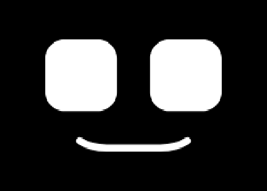<br>default</td><td align="center">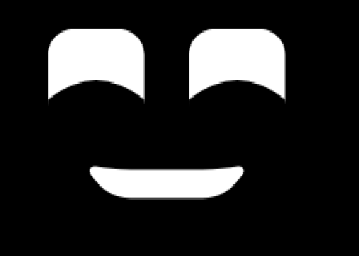<br>happy</td><td align="center">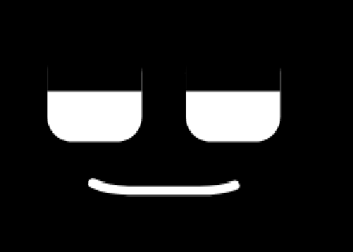<br>smirk</td><td align="center">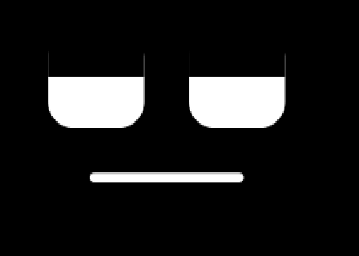<br>bored</td></tr>
<tr><td align="center">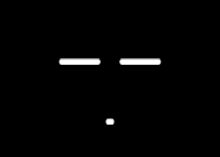<br>asleep</td><td align="center">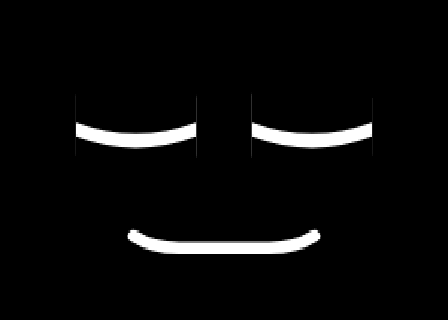<br>peaceful</td><td align="center">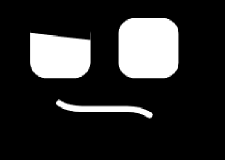<br>confused</td><td align="center">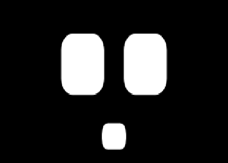<br>surprised</td></tr>
<tr><td align="center">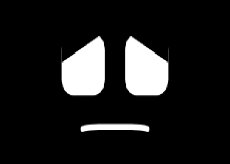<br>sad</td><td align="center">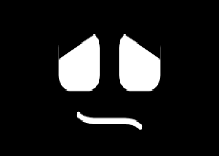<br>worried</td><td align="center">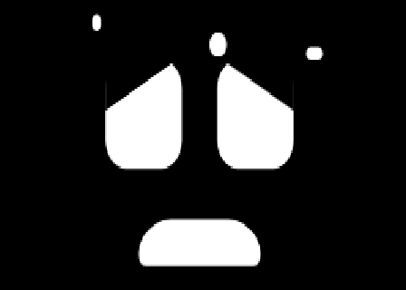<br>scared</td><td align="center">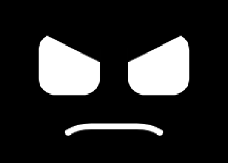<br>angry</td></tr>
<tr><td align="center">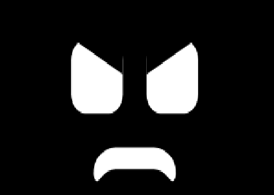<br>furious</td></tr>
</table>

## The mouth

Always a single line under the eyes. Only three things change: its length, its height and how far each corner bends.

- `setMouthWidth(px)`: length; `0` shrinks it away completely (it thins as it goes, so no dot is left)
- `setMouthGap(px)`: height, as the space between the bottom of the eyes and the mouth
- `setMouthCorners(left, right)`: positive bends a corner up, negative down; the middle stays straight. With one
  argument, both corners bend the same
- `setMouth(ON | OFF)`: with the mouth on, a strip under the eyes is reserved so it never leaves the screen
- the mouth state sets the corners. The length stays at the face's `mouth.width` (50) unless `mouth.moodWidth` is on;
  then the mouth state's own `width` sets it
- `mouthThickness`: line weight
- `mouthRadius`: how round the corners of an open mouth are, like an eye's radius; only a corner with its own
  `leftOpen` or `rightOpen` has one to round

It moves with the eyes when they look around, shake their head or nod, and eases the same way they do. While
laughing it lifts with each bounce (`laughMouthAmplitude`) and opens.

## Configuration

Every setting of a face is in one object, `FaceConfig`. `src/config.ts` holds the defaults (`defaultConfig`).

```js
const eyes = new RoboEyes(canvas, { config: { mouth: { gap: 12 }, blink: { interval: 3 } } });
eyes.configure({ mouthStates: { smile: { left: 6, right: 6 } } }); // change anything later
const config = eyes.getConfig();                                  // everything, as plain JSON
```

Both take any part of the configuration; what is left out keeps its value. The sections are:

- `frameRate`
- `eyes`: `left` and `right` width, height and radius, `spacing`, and `closedHeight`, how tall a closed eye stays (3
  by default, the mouth's thickness, where the original uses 1) and `offsetY`, how far the face moves down from
  the screen's middle (0 by default: the eyes and mouth together are centred, so a centred look sits there)
- `mouth`: `gap`, `thickness`, `curl`, `width` (the face's mouth length, 50) and `moodWidth` (off by default, so the
  mouth stays at `width`; on, the mouth state's own `width` is used instead)
- `blink`: `interval` and `variation` (auto blink timing, in seconds) and `speed`, how much of the remaining way a
  blinking eye goes each frame (0.5, as the original). (shake head and nod have their own)
- `wander`: `interval` and `variation`, how often a wandering look moves on
- `follow`: `fullX` and `fullY`, how much of the way to the edge of the area being watched the point must be, across
  and down, for a follow look's eyes to turn fully (0.6 and 0.4 by default)
- `curious`, `laugh`, `shakeHead`, `nod` and `shake`: the amounts and timings for those (`shakeHead` and `nod` each have
  an `amplitude` and a `speed`, like `blink.speed`; `laugh` has `frequency` (bounces a second), `amplitude` and
  `mouthAmplitude` (pixels), `squint` and `mouthOpen`)
- `modes`: `cyclops`, `mouth`, `smooth` and `reducedMotion`. With reduced motion each pose holds and nothing keeps
  moving: no auto blink, wander, shake, sweat, laugh, head shake or nod, and
  the talk toggle's mouth rests shut. Moving between poses still eases, and `speak()` still plays. `'auto'` (the
  default) follows the system's `prefers-reduced-motion` setting; `true` or `false` sets it either way
- `look`: the look the face has now (the face starts with `wander`)
- `toggles`: what each toggle is when a mood leaves it out
- `eyeStates`, `mouthStates`, `looks` and `moods`: the face states and moods, by name. Add a key to add one

An eye state is two eyelids, `top` and `bottom`, which both eyes share, and `closed` (`true`, `false`, or `'left'`
or `'right'` for a wink). `left` and `right` give one eye (as seen on screen) its own lids: only what differs, laid
over the shared ones, e.g. `left: { top: { height: 0.4 } }`. Lid sizes are fractions of the eye's height:

- `height`: how far the lid comes over the eye at its corners (0 open, 1 covered)
- `angle`: 1 lowers only the outer corner (sad), -1 only the inner corner (angry), 0 keeps the lid level
- `curve`: positive takes the middle of the lid further in than its corners (an arch); negative takes the corners
  further in than the middle (a bowl, rounding off the eye's corners). Either way, `height` is the depth at the
  shallower part

A mouth state is `left` and `right` (how far each corner bends, in pixels), optionally `open`, `leftOpen` and `rightOpen`
(how far the middle and each corner open downwards, in pixels, so the line becomes a rectangle; the strip under the eyes
reserves room for the largest) and optionally `width`, which only counts
when `mouth.moodWidth` is on unless the state also has `ownWidth: true` (as `closedGasp`, a dot, does). With
`followLook: true` (as `smirk`) the corners swap as the eyes look left, so the smirk curls up on the side away from
where they look. The `talk` toggle keeps whichever mouth state is in use opening and closing at random, up to its open amounts (or `talk.open` pixels if it has none), like syllables; `setTalk(true)` turns it on and a mood can set `talk`. The `talk` settings set its pace (`syllableMs`, `variationMs`, `pauseChance`) and how natural it looks: the upper lip lifts
with the opening (`lipLift`) and each corner follows the opening loosely and sways (`cornerSway`) on its own timing.
`speak(text, { speed })` says some text instead: the spelling is turned into sounds by letter rules (and a short list of irregular words),
and each sound is a mouth shape from `talk.visemes` (`open`, `corner`, `width`, `lift` and `lip` for each; tune them there). Sounds made without the lips
take on the vowel next to them, and fast speech opens less. It returns how long it takes in ms and works with any mouth state, with
the `talk` toggle off. For real lip sync, play your own timed list with `speakVisemes([{ viseme: 'ah', ms: 120 }, ...])` (for example from a
text-to-speech engine's viseme events), or hold one shape with `setViseme('oo')` and release it with `setViseme(null)`. A look is `x` and
`y`, fractions of how far the eyes can move (0 left or top, 1 right or bottom). `wander: true` makes it wander instead (`wander: { interval, variation }` sets its own pace in seconds, as `lookAround` does);
`follow: true` makes it follow the point `lookAt(x, y)` gives (fractions, like `x` and `y`; the demo points it at
the mouse); `shakeHead: true` keeps the head shaking, and `nod: true` keeps it nodding, while the eyes look there.
`shakeHead: { amplitude, speed }` and `nod: { amplitude, speed }` give that look its own swing instead of the
`shakeHead` and `nod` settings', e.g. a small quick nod for excited. `path: [{ x, y, holdMs }, ...]` takes the eyes to
each point in turn, holding each for `holdMs`, and starts again after the last (as `glanceUp` and `scan` do); it waits
while the eyes are closed, and with reduced motion the eyes rest at the look's own `x` and `y`. The demo edits a path
in the configuration JSON only.

A mood names its face states, sets toggles, and can change its eye and mouth states for itself only with `override`.
It can also set how big the eyes are, with `scale` (a multiple of their size, so `1.12` is 12% bigger; each eye grows
from its centre, lids and all, and big ones can reach past the screen's edge), and when they blink, with `blink`
(`interval` and `variation` in seconds, like the face's `blink`; what it leaves out is the face's own):

```js
eyes.configure({ moods: {
  napping: { eyes: 'closed', mouth: 'flat', look: 'S' },
  smug:   { eyes: 'angry', mouth: 'smirk', look: 'NE', override: { eyes: { top: { height: 0.25 } } } },
  excited: { mouth: 'flat', scale: 1.12, blink: { interval: 5, variation: 0 } },
} });
```

`null` in a mood removes that choice, as if the mood had left it out.

Moods and face states can be filed in folders with `group`, a path such as `'Anger/Furious'`. Folders only organise
them (the demo shows them as collapsible lists); they change nothing about how a face behaves, and every name must
still be unique within its kind.

`demo.html` is a face builder: a control for every setting, in tabs (Play, Moods, Face, Eyes, Mouth, Looks, Behaviour), and an
Import / Export tab that saves a face as a JSON file (all of it, or only what differs from the starting face), loads one
back (by file, drop or paste) and saves the face as an image. The mood pickers show each mood's face, redrawn when you
change a setting. Your work is kept in the browser between visits.

## Differences from the Arduino version

- `precision: 'smooth'` (the default, `modes.smooth`) uses fractions for softer motion on big screens. `'pixel'` keeps
  the original's whole-number maths, quirks included (open eyes stop one pixel short of full height).
- The original's idle mode is the `wander` look, and the face starts with it; the original starts with idle off.
  `setIdleMode(OFF)` looks to the center.
- Eyelids are cut out of the eyes rather than painted over them in the background colour, which gives clean edges
  and supports a transparent background.
- Moods are combinations of face states from the configuration, so the `tired`, `angry` and `happy` flags and the
  `eyelids*` fields are gone. The original's tired mood is called sad here (`TIRED` still works as another name for
  `SAD`). The sad and angry eye states are the original triangles; happy is a curve close to the original's rounded
  rectangle.
- `begin()` re-centres the eyes for the new screen size.
- Laughing is a toggle (`setLaugh()`, or a mood's `laugh`; `anim_laugh()` turns it on) instead of a one-shot move: until
  it is turned off the eyes lift and squint and the mouth opens and lifts with each bounce, at `laughFrequency`.
  Shaking the head (`shakeHeadAmplitude`,
  `shakeHeadSpeed`) is a look and takes the mouth with it. `setVFlicker()` and `setHFlicker()` still
  shiver every frame, as in the original.
- New: a nod look swings the eyes and mouth down and up the same way (`nodAmplitude`, `nodSpeed`).
- New: the `closed` eye state keeps the eyes closed until another eye state is set. Auto blink and wander wait
  meanwhile.
- Curious, sweat, talk and shake (the original's horizontal flicker) are toggles, so a mood can turn them on or off.
  `setVFlicker()` still works but is not a toggle, so no mood changes it. The toggles' setters set them until the
  next mood.
- New moods, beyond the original's: `SMIRK` (open eyes with the top lids half down, smirk), `ASLEEP` (closed eyes
  looking straight ahead, the closed gasp mouth's dot, auto blink off), `PEACEFUL` (sleepy eyes looking straight ahead, auto blink off),
  `WORRIED` (sad eyes, wry mouth) and `FURIOUS` (angry eyes, open frown, wandering, curious and shaking), and, without
  constants, `confused` (confused eyes, wry mouth), `laughing` (happy eyes, the laugh mouth, laugh on),
  `proud` (happy sad eyes, the smile mouth),
  `curious` (open eyes, the open gasp mouth, following the mouse and curious),   `surprised` (open eyes, the open gasp mouth) and `scared` (worried, but with a flat-bottomed frown, sweating, shaking and looking around quickly).
- Auto blink is a toggle, so a mood can turn it off (`autoblink: false`); `setAutoblinker()` sets it until the next
  mood.
- Closed eyes are 3 pixels tall, the mouth's thickness, instead of the original's 1 (`closedHeight`).

## Build

`node build.mjs` (needs `tsc`) writes `dist/roboeyes.js`, `dist/config.js`, their `.d.ts` files and
`dist/roboeyes.global.js`.
